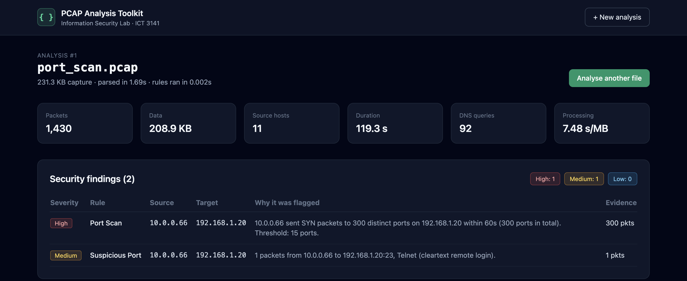
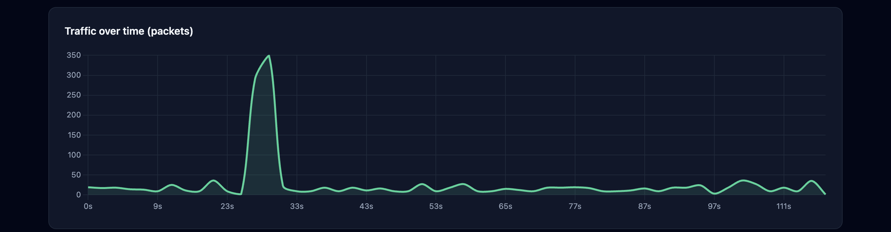
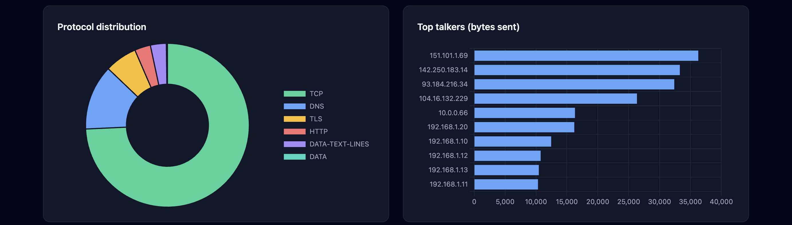
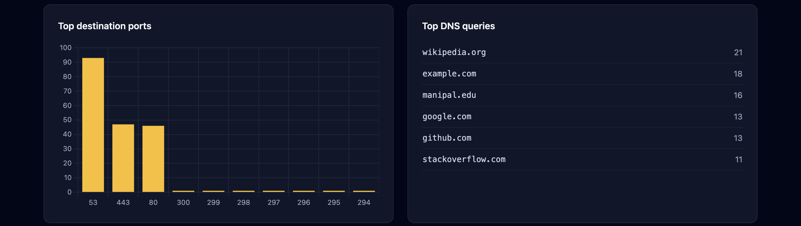
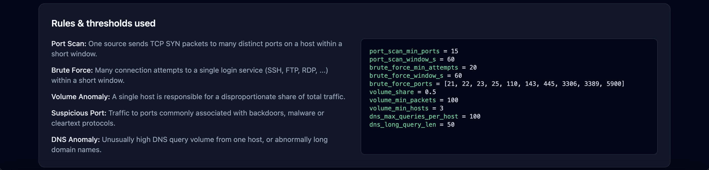

# Automated PCAP and Network Traffic Analysis Toolkit

Information Security Lab (ICT 3141) mini-project, B.Tech CCE 5th Semester, MIT Manipal.

A lightweight web tool that takes an uploaded PCAP file, parses packet metadata with PyShark, stores it in SQLite, runs explainable rule-based security checks, and shows the findings on a dashboard.



## Team

| Name | Roll No | Module |
|---|---|---|
| Aanya Singhal | 08 | Threat detection rules, Flask dashboard, visualization, PDF report |
| Sanjai G | 19 | SQLite database design, storage, SQL queries, traffic statistics |
| Akshat Richhariya | 17 | PCAP parsing with PyShark/TShark, metadata extraction |

**Faculty:** Dr Adesh ND, Dr Chithra K

## Pipeline

**Upload → Parse → Store → Detect → Visualize → Report**

| Stage | Implementation |
|---|---|
| Upload | Flask upload form (`.pcap`, `.pcapng`, `.cap`, max 50 MB) |
| Parse | `parser/pcap_parser.py`: PyShark extracts IPs, ports, protocol, timestamps, TCP flags, DNS queries, HTTP requests |
| Store | `database/db.py`: SQLite tables `packets`, `dns_queries`, `http_requests`, `findings`, `analyses` |
| Detect | `detection/rules.py`: SQL + Python rules with configurable thresholds |
| Visualize | `templates/dashboard.html`: summary cards, findings table, 4 Chart.js charts, DNS table |
| Report | PDF export (planned, Week 6) |

## Detection Rules

| Rule | Logic | Default threshold |
|---|---|---|
| Port Scan | One source sends TCP SYN to many distinct ports on a host (sliding window) | 15 ports / 60 s |
| Brute Force | Repeated connection attempts to a login service (SSH, FTP, RDP, SMB, ...) | 20 attempts / 60 s |
| Volume Anomaly | One host sends a disproportionate share of all bytes | ≥ 50% (min 100 packets, 3 hosts) |
| Suspicious Port | Traffic to backdoor / cleartext ports (4444, 31337, 12345, 23, 6667, ...) | any |
| DNS Anomaly | High query volume from one host, or very long domain names | 100 queries / 50 chars |

Every finding states which host triggered it, the threshold used and the evidence count. Findings are indicators for investigation, not proof of malicious activity.

## Setup and Run

Requires Python 3.10+ and TShark (install Wireshark from wireshark.org, or `brew install wireshark`).

```bash
git clone https://github.com/aanya-singhal/pcap-traffic-analysis-toolkit.git
cd pcap-traffic-analysis-toolkit
python -m venv venv
source venv/bin/activate
pip install -r requirements.txt
python app.py
```

Open http://127.0.0.1:5001 and upload a capture (sample files are in `samples/`).

## Testing and Preliminary Results

```bash
python tests/generate_test_pcaps.py   # builds 5 labelled captures in samples/
python tests/run_evaluation.py        # runs the full pipeline and scores the rules
```

Each test capture contains normal background traffic (4 hosts browsing over HTTP/HTTPS with DNS) plus one known attack. Expected findings are stored in `samples/expected_findings.json`.

| Capture | Expected | Detected | Result |
|---|---|---|---|
| normal_traffic.pcap | none | none | PASS |
| port_scan.pcap | Port Scan, Suspicious Port | Port Scan, Suspicious Port | PASS |
| brute_force_ssh.pcap | Brute Force | Brute Force | PASS |
| volume_exfil.pcap | Volume Anomaly | Volume Anomaly | PASS |
| dns_tunnel_c2.pcap | DNS Anomaly, Suspicious Port | DNS Anomaly, Suspicious Port | PASS |

- **TPR:** 100% (6/6) · **FPR:** 0% (0/19) · **Database completeness:** 100% of packets stored
- **Processing time:** ~2–18 s/MB (PyShark parsing is the bottleneck)

These are synthetic captures, so the results validate rule correctness. Evaluation on public datasets (Wireshark samples, PCAP-ATTACK) is the next phase. Full table: [docs/evaluation_results.md](docs/evaluation_results.md).

## Live Capture Demo (extension beyond planned scope)

The original synopsis scoped the toolkit to **offline analysis of uploaded PCAP files only**. As an extension, we added an optional live-capture mode and a fully reproducible, self-contained demo that catches an attacker **in real time** on a private Docker network. This exercises the same parse → store → detect → visualize pipeline on traffic sniffed from the wire instead of a file; the upload flow is unchanged.

The demo brings up three containers on one isolated bridge network:

| Container | Role |
|---|---|
| `receiver` | Runs the dashboard **and** is the victim; captures its own interface with TShark |
| `attacker` | Loops an nmap SYN port scan (incl. backdoor ports 4444 / 31337) and an SSH brute-force burst against the receiver |
| `client` | Loops normal web requests to the receiver, providing a benign baseline |

```bash
docker compose up --build
# open http://localhost:5001  ->  click "Capture live traffic (20s)"
# view logs from all 3 containers:
./view_logs.sh
```

After ~20 s the dashboard shows the attacker's scan and brute-force **caught live** — Port Scan, Brute Force and Suspicious Port findings — standing out against the client's normal traffic. Everything targets our own receiver on an isolated network; nothing leaves the host.

Live capture requires TShark and permission to read the interface, so the button appears only when TShark is available (always true inside the `receiver` container). The capture interface and window are configurable via `CAPTURE_IFACE` and `CAPTURE_SECONDS`.

## Screenshots

| | |
|---|---|
|  |  |
|  |  |

## Project Structure
app.py Flask app and pipeline orchestration
parser/pcap_parser.py PCAP parsing and field extraction
database/db.py SQLite schema, inserts and traffic-statistics queries
detection/rules.py Rule-based detection engine
templates/ Upload page and dashboard
samples/ Labelled test captures + expected findings
tests/ Test capture generator and evaluation script
docs/ Development log, evaluation results, screenshots
Dockerfile App image (Python + TShark) for the live-capture demo
docker-compose.yml Three-container live-capture demo (receiver / attacker / client)
docker/ Attacker + client scripts and their image


## Progress (Stage II)

Weeks 1–4 of the plan are complete (scope, parsing, storage, detection rules), and the Week 5 dashboard is already working. See [docs/devlog.md](docs/devlog.md) for progress against plan, issues encountered and how they were resolved.

**Next:** PDF report export, evaluation on public datasets, configurable thresholds from the UI.

## Scope

The core toolkit performs offline analysis of authorized PCAP files; it does not decrypt encrypted payloads. The synopsis originally listed live capture as out of scope — we have since **extended beyond that plan** with the optional Docker-based live-capture demo above, which captures only our own receiver container on an isolated private network. The upload-only workflow remains the primary, always-available path.
